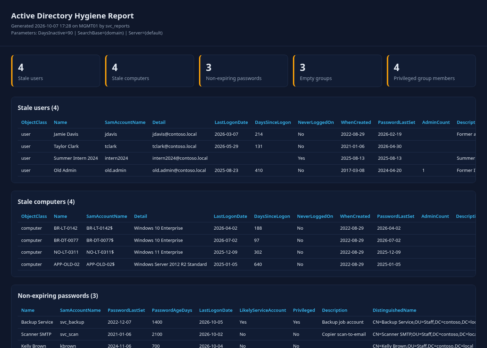

# AD Hygiene Toolkit

[](https://github.com/john-harrington-it/ad-hygiene-toolkit/actions/workflows/ci.yml)


A PowerShell module that finds Active Directory clutter, shows it in one HTML dashboard, and lets you clean it up safely. Every change supports `-WhatIf` and `-Confirm` and is written to a log.



## The problem

Every directory builds up debris: accounts for people who left, laptops that were reimaged years ago, service accounts whose passwords never expire, project groups nobody uses, and admin rights that outlived the person's role. Each of these widens the attack surface and makes audits slower. Most teams know the problem exists but have no repeatable way to measure it or fix it safely.

## Features

| Area | Command | What it reports |
|---|---|---|
| Stale users | `Get-AdhStaleUser` | Enabled users with no sign-in for N days. New hires who haven't signed in yet aren't flagged. |
| Stale computers | `Get-AdhStaleComputer` | Enabled computers with no authentication for N days, plus machine password age. |
| Non-expiring passwords | `Get-AdhNonExpiringPasswordAccount` | `PasswordNeverExpires` accounts, password age, likely service accounts (SPN), privileged flag |
| Empty groups | `Get-AdhEmptyGroup` | Groups with no members. Built-in groups whose members are assigned by primary group (like Domain Users) are skipped. |
| Privileged access | `Get-AdhPrivilegedGroupMember` | Recursive membership of Domain/Enterprise/Schema Admins and other high-privilege groups. Flags disabled, stale, non-expiring, old-password, and non-user members. |
| Full audit | `Invoke-AdhAudit` | Runs everything and writes `index.html` plus one CSV per check |
| Remediation | `Invoke-AdhStaleObjectRemediation` | Disable and/or move stale objects to a quarantine OU, with guardrails |

The reporting commands only read the directory. Nothing is ever deleted.

## Requirements

- Windows PowerShell 5.1 or PowerShell 7.x
- The **ActiveDirectory** module (RSAT: Active Directory DS and LDS Tools), on a domain-joined management host or a domain controller
- Read access to the directory for reports. For remediation, delegated rights to disable accounts and move objects in the target OUs.

## Install

```powershell
git clone https://github.com/john-harrington-it/ad-hygiene-toolkit.git
Import-Module ./ad-hygiene-toolkit/src/AdHygieneToolkit/AdHygieneToolkit.psd1
Get-Command -Module AdHygieneToolkit
```

## Usage

```powershell
# Full audit: HTML dashboard + CSVs
Invoke-AdhAudit -OutputPath C:\Reports\AD -DaysInactive 90 -ExcludeSamAccountName 'svc_*'

# Individual checks compose with the pipeline
Get-AdhStaleUser -DaysInactive 120 -SearchBase 'OU=Staff,DC=contoso,DC=local' |
    Sort-Object DaysSinceLogon -Descending |
    Format-Table Name, SamAccountName, LastLogonDate, DaysSinceLogon

# Only privileged members that need attention
Get-AdhPrivilegedGroupMember | Where-Object Flags | Format-Table Group, SamAccountName, Flags -Wrap

# Preview remediation (changes nothing)
Get-AdhStaleComputer -DaysInactive 120 |
    Invoke-AdhStaleObjectRemediation -Action DisableAndMove -TargetPath 'OU=Disabled Computers,DC=contoso,DC=local' -WhatIf

# Apply after review (prompts per object unless -Confirm:$false)
Get-AdhStaleUser -DaysInactive 180 | Invoke-AdhStaleObjectRemediation -Action Disable
```

Two ready-made scripts are in [`examples/`](examples): a monthly scheduled audit that keeps a year of reports, and a preview-then-apply quarantine for stale computers.

## Sample output

The screenshot above and [`docs/sample-report.html`](docs/sample-report.html) were generated from **synthetic data** (contoso.local). The audit returns a summary object:

```text
ReportPath               : AdhReport-sample/index.html
OutputPath               : AdhReport-sample
StaleUsers               : 4
StaleComputers           : 4
NonExpiringPasswords     : 3
EmptyGroups              : 3
PrivilegedMembers        : 4
PrivilegedMembersFlagged : 3
```

Remediation returns one result per object (here with `-WhatIf`):

```text
What if: Performing the operation "Disable account and stamp description" on target "CN=Jamie Davis,OU=Staff,DC=contoso,DC=local".

DistinguishedName                           Action  Status  Message
-----------------                           ------  ------  -------
CN=Jamie Davis,OU=Staff,DC=contoso,DC=local Disable WhatIf  Preview only; no change made.
CN=Old Admin,OU=Staff,DC=contoso,DC=local   Disable Skipped Protected object (adminCount=1). Use -IncludeProtected to process.
```

## Safety notes

- **Reports are read-only.** `Get-*` and `Invoke-AdhAudit` never write to AD.
- **`ConfirmImpact = 'High'`** on remediation: PowerShell prompts for each object unless you pass `-Confirm:$false`.
- **`-WhatIf` changes nothing**, and the log is still written so you keep a record of the preview.
- **Batch cap:** `-MaxObjects` (default 25) refuses oversized input, which protects you from a bad filter.
- **Protected accounts:** objects with `adminCount=1` are skipped unless you pass `-IncludeProtected`.
- **Reversible:** remediation only disables and moves objects. The original description is kept after a dated stamp (`Disabled by AD Hygiene Toolkit 2026-10-07; previous: ...`).
- **lastLogonTimestamp lag:** this attribute replicates every 9–14 days, so thresholds under 30 days are rejected.
- Check accounts that run services or scheduled tasks before you disable them. Use `-ExcludeSamAccountName` / `-ExcludeName` for known exceptions.

## Testing

The test suite mocks every ActiveDirectory cmdlet, so it runs on any OS with no domain:

```powershell
Install-Module Pester -MinimumVersion 5.5 -Scope CurrentUser -SkipPublisherCheck
Install-Module PSScriptAnalyzer -Scope CurrentUser
./build.ps1      # PSScriptAnalyzer (0 findings required) + Pester with code coverage
```

The tests cover threshold logic, exclusions, `-WhatIf` (no AD calls made), description stamping, the batch cap, protected-object skipping, per-object error handling, HTML encoding of directory data, and comment-based help for every exported command. CI runs the same script on Ubuntu and Windows (`.github/workflows/ci.yml`).

## Layout

```text
src/AdHygieneToolkit/   module manifest, loader, Public/ and Private/ functions
tests/                  Pester 5 tests (AD cmdlets mocked) + module quality gates
examples/               scheduled audit and quarantine scripts
docs/                   sample report generated from synthetic data
build.ps1               analyzer + tests, same locally and in CI
```

## Author

**John Harrington**, Systems Engineer. [LinkedIn](https://www.linkedin.com/in/john-harrington-9022649a)

## License

[MIT](LICENSE)
